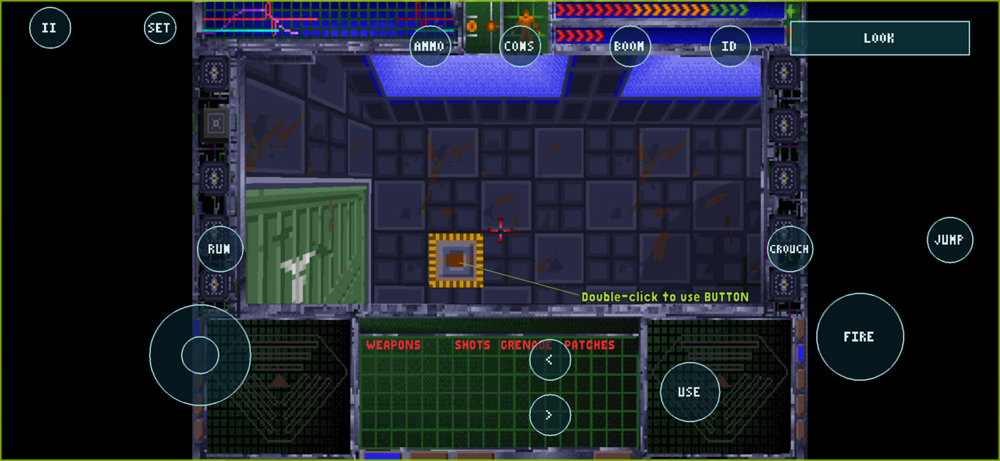

# System Shock Touch Edition (Android)

An unofficial Android/ARM64 build of *System Shock* (1994) that you can play on a phone with touch controls alone. It is
based on the [Shockolate](https://github.com/Interrupt/systemshock) source port and on
[System Shock — Android](https://github.com/raposomiguel50/system-shock-android) v1.0.0 by raposomiguel50, which
targets controller handhelds such as the Retroid Pocket 5. This repository adds a full touchscreen control scheme, its
own app identity and the fixes needed to run it on a phone.

Version 1.1.0-beta.2 in game on a Galaxy S26 Ultra (Android 17), 2026-11-10.

## Download

**Official download: [system-shock-android Releases](https://github.com/thekojac304/system-shock-android/releases)**
(current: [1.1.0-beta.2](https://github.com/thekojac304/system-shock-android/releases/tag/v1.1.0-beta.2),
`SystemShock-TouchEdition-1.1.0-beta.2-arm64-v8a.apk`, 3.7 MB). That repository holds the reviewed release source.

This repository is the development history. Its releases are archived copies of the same APK files, kept with the
tags they were built from; they are marked as pre-releases so the official repository stays the one download location.

The APK contains no game data. You need the `res` folder (with `data` and `sound`) from your own copy of System Shock.

## Install and play

1. Download the APK on your Android device and install it. Android asks you to allow installs from your browser or
   file manager the first time.
2. Open **System Shock (Touch Edition)**.
3. Tap **Select res folder** and pick your System Shock `res` folder, the one that contains `data` and `sound`.
   The app copies it into its private storage. No storage permission, ADB or PC is needed.
4. The game starts. Tap to skip the intro.

Keep your original game files. Uninstalling the app deletes its private copy of the game data and its saves.

The app installs **beside** upstream's `io.github.raposomiguel50.systemshock`, not over it. Saves don't move between the
two apps automatically.

## Touch controls

- **Floating move stick** on the left, **swipe to look** on the right, with adjustable sensitivity and invert Y.
- **FIRE** (drag to aim), **USE**, **JUMP**, **CROUCH**, **RUN** (sprint latch) and **ID** (target identification).
- **LOOK / CURSOR** mode toggle: cursor mode drives the original mouse interface (MFDs, inventory, containers,
  fullscreen toggle) with taps and drags that follow the game's own click and double-click rules.
- **Quick actions:** weapon cycling, **AMMO**, **CONS** (patches) and **BOOM** (grenades) using the game's own hotkeys.
- **Optional radial wheels** (off by default): hold the weapon, CONS or BOOM button to pick a weapon slot, patch type
  or grenade type from what you're carrying. Optional haptics, also off by default.
- **Layout editor (SET):** move and resize buttons, change opacity and stick size. Settings survive restarts and
  updates.
- **Pause (II)** opens the game menu. The Android keyboard opens for the new-game name.

Upstream's controller input code is kept. Details: [Touch Alpha 3](docs/TOUCH_ALPHA_3.md) (settings and
layout), [Touch Alpha 4](docs/TOUCH_ALPHA_4.md) (radial wheels and haptics).

## Status

**Beta.** Version 1.1.0-beta.2 was tested on a Galaxy S26 Ultra (SM-S948U1, Android 17) on 2026-11-10:

| Area | Result |
|---|---|
| Install, and update over beta.1 | Works |
| Game-data import through the folder picker | Works (143 files, 316 MB) |
| Landscape 3D rendering, intro cutscene, main menu | Works |
| Touch movement and action buttons, pause menu | Works |
| Audio | Starts (48 kHz stereo track playing, not muted); checked from the system audio state, not by ear |
| Save, force-stop, cold start, load | Works |
| Long play sessions | Not tested |
| Retroid Pocket 5 with this APK | Not tested (the touch work was validated there on earlier QA builds) |

## Known limitations

- Save slots can't be named from touch: the keyboard only opens on the new-game screen, so saves show a blank name.
  Saving and loading work.
- Android 13 or later, ARM64 only.
- Only a short play session has been tested on a phone.

## Requirements

- An ARM64 phone, tablet or handheld with Android 13 or later.
- A legally obtained copy of System Shock: the `res` folder of the CD-ROM release or System Shock: Enhanced Edition
  (the floppy release isn't supported). See [compatible game data](docs/GAME_DATA.md).

## Differences from upstream

| | Upstream System Shock — Android v1.0.0 | This Touch Edition |
|---|---|---|
| Package | `io.github.raposomiguel50.systemshock` | `io.github.thekojac304.systemshock`, own signing key |
| Main input | Controller; touch is an optional pointer | Full touch scheme (above); controllers still work |
| Phones | Not a target | Import crash on phones held upright fixed (beta.2) |
| Build fixes | — | Intro movie decoder overread fix; 16 KB native-library alignment |
| Experimental rendering | — | OpenGL ES world rendering and lighting research in the source (QA builds only; see `docs/GPU_*` and `docs/HORROR_*`) |

Everything else (the engine, game logic, original graphics and sound, the importer) is Shockolate and upstream's work.

## Source and branches

This repository holds the full development history of the Touch Edition. Phone serial numbers and local user paths
in it were redacted (`<device-serial>`, `<user>`), so commit hashes after the upstream baseline differ from the
original private history. Upstream commits and tags keep their original hashes. Reviewed release sources and the
APK are published in [system-shock-android](https://github.com/thekojac304/system-shock-android).

| Branch | What it is |
|---|---|
| `touch-controls` (default) | Touch controls and engineering work |
| `release/custom-1.1.0-beta.1` | The release line: `touch-controls` plus the Touch Edition identity and the beta.2 fix. Tag `v1.1.0-beta.2` = `55f4fa3` |
| `main` | Upstream v1.0.0 documentation line |

## Building from source

Windows with PowerShell 7, JDK 17, Android SDK 34/35 build tools and NDK `29.0.14206865`. The full steps are in
[docs/BUILD.md](docs/BUILD.md) (written for upstream; use this repository's URL and the
`release/custom-1.1.0-beta.1` branch). Sign release builds with your own key.

## Credits and license

- [Shockolate](https://github.com/Interrupt/systemshock) by Interrupt and contributors, the GPL source port of the
  System Shock engine.
- [System Shock — Android](https://github.com/raposomiguel50/system-shock-android) by raposomiguel50: the Android
  port, importer, controller support and release tooling this build starts from. Its original README is kept in
  [docs/UPSTREAM_README.md](docs/UPSTREAM_README.md).
- SDL2 and SDL_mixer: see [THIRD_PARTY_NOTICES.md](THIRD_PARTY_NOTICES.md).

GPL-3.0-or-later ([LICENSE](LICENSE)). System Shock is a trademark of its owners. This build is not affiliated with or
endorsed by Night Dive Studios, Looking Glass Studios or the upstream authors.
